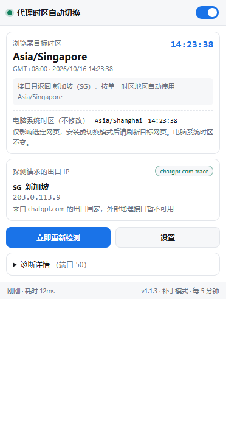

# Proxy Timezone Sync · 浏览器时区自动切换

[GitHub 仓库](https://github.com/simplifyOurLife/proxy-timezone-sync) · [版本发布](https://github.com/simplifyOurLife/proxy-timezone-sync/releases) · [问题反馈](https://github.com/simplifyOurLife/proxy-timezone-sync/issues)

Chrome 125+ 的 Manifest V3 扩展：观测目标网站探测请求的出口 IP，定位城市时区，并修改选定网页看到的浏览器时区。

**不会修改 Windows／macOS／Linux 的系统时区。** 任务栏时钟、其他软件、Chrome 内部页面和扩展设置页仍使用系统时区。时区一致也不能保证解决网站风控或 `model not found` 报错。

主要功能：自动定位目标出口、手动指定时区、按域名控制作用范围、补丁／CDP 两种引擎、默认折叠的诊断信息。



图中 IP 为文档测试地址，不代表任何实际用户出口。

## 安装与升级

1. 在 `chrome://extensions/` 开启开发者模式，加载本目录。
2. 升级已有安装时点击扩展的“重新加载”，随后刷新所有目标网页，清除旧补丁和网页缓存的旧时区。
3. 在弹窗点击“立即重新检测”，查看目标时区、出口来源和异常提示。
4. 默认只修改 `chatgpt.com`、`openai.com` 及其子域。其他网站需要先加入设置中的“修改时区的域名”；留空表示全部 HTTP(S) 网站及获准的文件网页。

无需安装依赖或执行 build。不要把工作中的 `.git`、日志或原生宿主机生成的注册文件上传到扩展商店。

从发布 ZIP 安装的完整步骤见 [INSTALL.md](INSTALL.md)。普通 Windows／macOS Chrome 对商店外 CRX 安装有限制；CRX 打包并不改变安装政策。

工具栏图标为开关外观：绿色圆点靠右表示开启，灰色圆点靠左表示关闭；橙色表示已开启但还没有有效时区，红色表示部分页面应用异常。悬停可看完整状态和目标时区；点击打开详情，弹窗顶部可切换开关。图标上不再叠加城市名文字。

弹窗默认显示时区、出口摘要和操作按钮；代理识别证据、端口列表、各地理接口结果及异常统一放在默认折叠的“诊断详情”中。点击即可展开，再次点击收起。页脚显示版本号，升级到本次修复后应为 v1.1.3。

## 出口识别与分流

默认先请求 `https://chatgpt.com/cdn-cgi/trace`，取得该请求看到的 IP，再请求 `ipwho.is/<IP>` 等 HTTPS 地理接口。地理接口必须返回同一个 IP；空响应、无效时区和 IP 不匹配会继续尝试下一接口。只有国家的响应不会阻止后续接口返回城市时区。

这确认的是**该域名本次探测请求**的出口。代理若按路径、IPv4/IPv6、进程或时间分别选节点，其他请求仍可能不同。`openai.com` 或其他域名不保证与 `chatgpt.com` 共用出口；请在代理规则中让需要一致的站点使用同一节点，或调整目标出口探测地址。

目标探测失败时，默认不切换，也不根据节点名猜测。只有你确认查询接口和目标网站共用出口时，才开启“公共接口兜底”。“国家主要城市兜底”默认关闭，因为美国、加拿大、澳大利亚等国家不能仅凭国家确定时区。

如果出口已确认，但接口只返回国家，已核实的单一时区地区会自动映射，无需开启主要城市兜底。目前支持新加坡、日本、中国香港／澳门／台湾、韩国、泰国、菲律宾；依据 [IANA 时区表](https://data.iana.org/time-zones/tzdb/zone.tab)。其他地区优先等待接口返回具体时区，缺失时保持系统时区并提示手动指定。

外部地理接口全失败时，会保留目标 trace 中已经校验的 IP 和有效 `loc` 国家代码，继续按上述单一时区规则判断；未知国家或多时区国家不会因此猜测城市。`colo` 表示服务机房，不用于推断出口城市。只有 IP、没有有效国家时，弹窗仍显示该 IP，并提示手动指定时区。

新加坡的目标值应为 `Asia/Singapore`。它和 `Asia/Shanghai` 目前同为 UTC+8，切换成功后钟面时间仍会相同；请用目标网页的 `Intl.DateTimeFormat().resolvedOptions().timeZone` 检查时区标识。扩展弹窗中的“电脑系统时区”继续显示 `Asia/Shanghai` 是正常的。

本地代理软件识别保留为辅助诊断，端口、进程名与代理配置只是线索。“只在检测到代理时切换”默认关闭，避免 TUN 模式被端口识别结果拦住。

## 两种生效方式

### 补丁模式（默认）

Chrome 持久化注册两个按顺序运行的 MAIN world 脚本：对应时区的同步种子、Date/Intl 适配器，均在 `document_start` 执行。选定时区无需等待 storage 返回即可在新文档中生效。456 个小种子文件随扩展分发，每页只加载其中一个；提交或复制扩展时需一并保留 `src/content/zone-seeds/`。

Date 内部始终保存真实毫秒值：`getTime()`、UTC 方法、ISO/JSON、结构化克隆和已有日期不随时区变化。只转换本地 getter、setter、无时区构造／解析和本地格式化；夏令时重叠选较早时刻，缺口向前跨越。显式指定 Intl 时区保持调用方语义。

关闭或切换到 CDP 时恢复适配器持有的原生引用。已经创建的 Intl 格式化器按标准继续保持其创建时的时区；网页自己缓存的字符串也无法追溯修改，因此切换后应刷新目标网页。

补丁仅覆盖文档环境，包括可匹配的 iframe，不覆盖 Worker／Service Worker。JS 适配器可以被针对性识别，不承诺“不可检测”。

### CDP 模式

使用 `chrome.debugger` 与 `Emulation.setTimezoneOverride`，先撤销 JS 适配器，再接管选定标签页。关联子目标通过扁平会话和递归自动附着处理；新子目标先设置时区，再恢复执行。不支持 Emulation 的目标会记录覆盖错误，并放行执行，避免网页卡死。

标签页顶部会显示调试提示条。打开 DevTools 或手动取消调试会断开接管；刷新目标页或重新检测后才会重试。CDP 模式也遵守“修改时区的域名”和“不修改时区的域名”；进入排除域名时会恢复并断开该标签页。

不能保证捕获所有既有 Shared Worker、独立 Service Worker 或所有浏览器版本的子目标。CDP 时区底层可能在渲染进程内共享，同进程 iframe 的细粒度域名隔离不受本扩展保证。不要用“目标时区已显示”代替实际页面、iframe 和 Worker 自检。

## 验证

在作用范围内的普通网页控制台检查：

```js
Intl.DateTimeFormat().resolvedOptions().timeZone
new Date().getTimezoneOffset()
new Date(Date.now()).getTime() - Date.now() // 接近 0
new Intl.DateTimeFormat('en-US', { timeZone: 'UTC' }).resolvedOptions().timeZone // UTC
```

自带 `test/tz-check.html` 可检查首次读取、常用日期接口和 Worker。通过 file:// 打开时，需要在扩展详情页开启“允许访问文件网址”，并清空域名作用范围；也可以用本地 HTTP 服务打开，并把 localhost 加入作用范围。

自动测试（PowerShell）：

```powershell
$env:TZ = 'Asia/Shanghai'
npm test
```

包含静态引用校验、地理接口与代理识别、后台集成、Date/Intl 行为、切换／关闭／夏令时回归、引擎互斥、域名排除、子目标顺序和启动注入检查。模拟测试不能替代真实 Chrome 加载扩展后的验证。

可选浏览器测试 `tools/test-browser.cjs` 默认使用独立临时配置、受控响应和本地网页。设置 `TIMEZONE_TEST_PROXY` 为本机 HTTP 代理地址后，会额外执行真实出口检测；`TIMEZONE_TEST_EXPECTED_TZ` 指定预期时区，默认 Asia/Singapore。不要在代理地址中放入凭据。

本次自动测试及真实浏览器验证范围见 [docs/验证结果.md](docs/验证结果.md)。

## 可选原生宿主机

安装说明见 [native-host/INSTALL.md](native-host/INSTALL.md)。它只读进程名、监听端口和系统代理设置，不执行系统时区修改。安装器注册宿主机时会写当前用户的 HKCU 注册表；无需管理员权限。

## 隐私与权限

- 目标探测和地理接口查询不携带 Cookie／登录凭据，不采集聊天内容或账号信息。
- 地理查询会把观测到的**出口 IP 显式发送给第三方地理服务**。请求源 IP 也会被各接收站点看到；结果保存在本地 storage。
- 本地扫描仅连接 `127.0.0.1`。原生宿主机返回的信息不上传到地理服务。
- `debugger` 和 `<all_urls>` 是较强权限：用于选定网页覆盖、可配置探测端点和本机端口访问。默认作用范围限制运行行为，不等同于收窄安装时授予的权限。
- 没有统计、账号上报、远程代码或远程配置。

完整说明见 [PRIVACY.md](PRIVACY.md)。

## 开发与发布

使用 Node.js 22+ 运行检查，无 npm 依赖。公开仓库和 GitHub Actions 的准备材料见 [GitHub 发布准备](docs/GitHub发布准备.md)；工程与验证索引见 [documentation/architecture.md](documentation/architecture.md)。

Actions 在 main 推送或 PR 时检查代码；手动触发打包或推送版本标签后生成 ZIP，配置固定 CRX_PRIVATE_KEY 后额外生成 CRX。文件先保存为工作流产物，公开 Release 由维护者核验后创建。当前版本为发布候选，安装包需在打包工作流成功后获取。

变更记录见 [CHANGELOG.md](CHANGELOG.md)，贡献说明见 [CONTRIBUTING.md](CONTRIBUTING.md)。项目采用 [MIT 许可证](LICENSE)，允许使用、修改和分发，需保留版权及许可声明。
